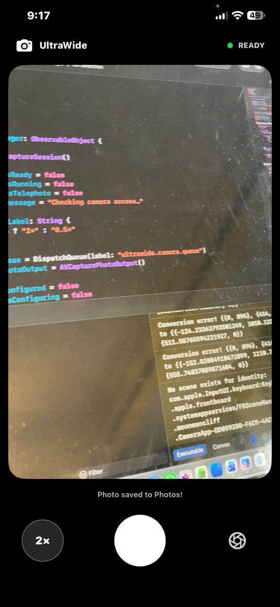
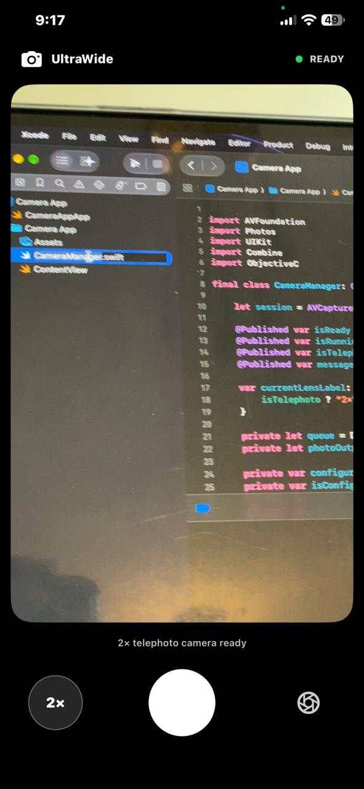
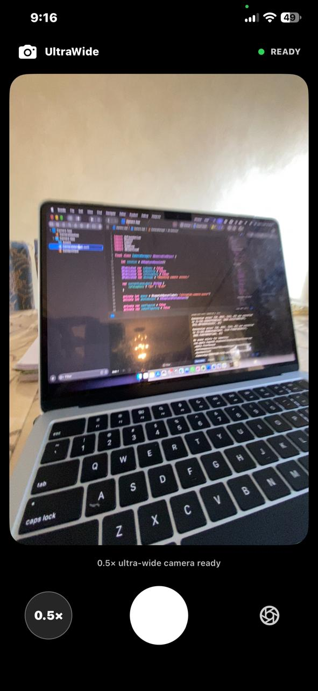

# 📸 Camera App for iOS

A custom iPhone camera app built with **Swift and AVFoundation**, featuring ultra-wide photography, quick lens switching, and direct photo saving to the Photos library.

## Screenshots

<!-- Replace the filenames below with your uploaded screenshot filenames. -->

<p align="center">
  
  &nbsp;&nbsp;
  
  &nbsp;&nbsp;
  
</p>

## Features

- **0.5× Ultra-Wide** — Start with the iPhone's ultra-wide rear camera.
- **2× Telephoto** — Switch quickly to the telephoto camera.
- **Photo Capture** — Take photos directly in the app.
- **Photos Integration** — Save captured images to the iPhone's Photos library.
- **Custom App Icon** — Personalized icon on the iPhone Home Screen.
- **Minimal Interface** — A simple, camera-focused experience.

## Tech Stack

- Swift
- SwiftUI
- AVFoundation
- Photos Framework
- Xcode

## Requirements

- A compatible iPhone with ultra-wide and telephoto cameras
- A Mac with Xcode
- An Apple account for device signing

## Installation

1. Clone this repository:

   ```bash
   git clone https://github.com/rayancheema/iPhone-Camera-App.git
   ```

2. Open the `.xcodeproj` file in Xcode.
3. Select the **Camera App** target.
4. Configure signing under **Signing & Capabilities** using your Apple account.
5. Select your connected iPhone as the run destination.
6. Press **⌘R** to build and run.

## Permissions

The app requests:

- **Camera access** to capture photos.
- **Photo Library add-only access** to save photos.

## Project Structure

```text
Camera App/
├── Camera App/
│   ├── CameraManager.swift
│   ├── ContentView.swift
│   ├── Assets.xcassets/
│   └── Info.plist
└── Camera App.xcodeproj
```

## Roadmap

- [ ] Add a photo gallery preview.
- [ ] Add haptic feedback for the shutter.
- [ ] Improve camera switching animations.
- [ ] Add more camera controls.

## Author

**Rayan Cheema**

Built as a personal iOS development project to explore native camera APIs and Swift development.
